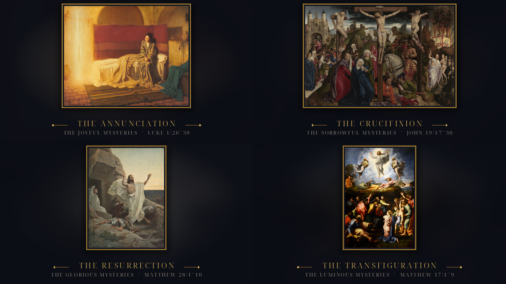
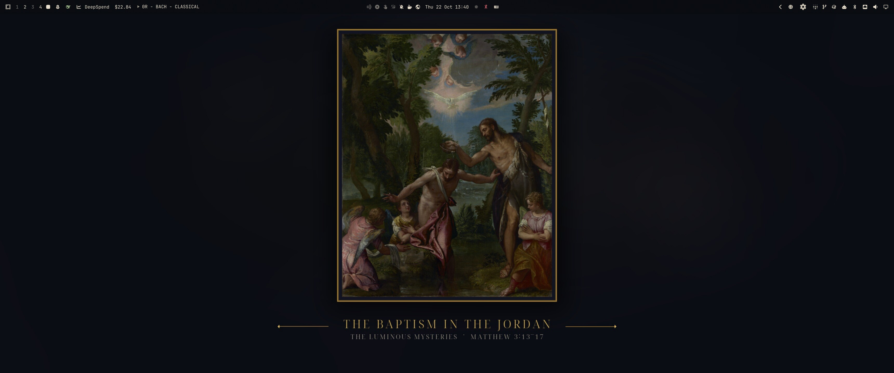
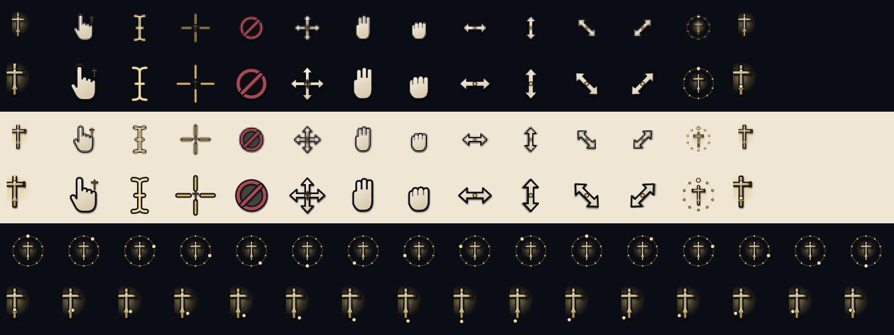

# Rosary for Omarchy

A candlelit sacred-art theme for [Omarchy](https://omarchy.org). Twenty
public-domain paintings cover all four sets of the Rosary; each day the theme
shows the paintings of that day's mysteries, then changes by itself at
midnight. Antique gold, ultramarine ink and parchment tie the varied paintings
together, with a small crucifix cursor, a rosary-bead wait cursor, a gold
crucifix badge for the lock screen and boot splash, and matching terminal rice.





## The daily rotation

The traditional weekday order is used:

| Day | Mysteries |
| --- | --- |
| Sunday | Glorious |
| Monday | Joyful |
| Tuesday | Sorrowful |
| Wednesday | Glorious |
| Thursday | Luminous |
| Friday | Sorrowful |
| Saturday | Joyful |

At install, `rosary-daily` puts the five paintings of the day into the theme's
`backgrounds/` folder and sets one as the wallpaper. A systemd user timer checks
every fifteen minutes, so the set changes shortly after midnight even if the
machine stays on. If you use the `dizziee.auto-wallpaper` plugin, it keeps
cycling through those five; otherwise `rosary-daily` advances through them
itself every 30 minutes. The theme also installs an Omarchy `theme-set` hook and
a `post-boot` hook, so switching back to Rosary or rebooting always lands on the
right set.

```sh
rosary-daily --status      # today's set, what is on screen
rosary-daily --force       # recopy the set and show its first painting
rosary-daily --tick        # move to the next painting now
rosary-daily --print-set   # joyful | sorrowful | glorious | luminous
```

## What is inside

| Piece | What it does |
| --- | --- |
| **Theme** (`colors.toml`, `hyprland.lua`, `btop.theme`, `icons.theme`, `chromium.theme`) | Ultramarine night, parchment text, antique-gold accent, oxblood for the Passion. Focused borders run gold to ultramarine. |
| **Wallpapers** (`paintings/`) | All 20 mysteries as 3440×1440 gallery plates, built 21:9 so Omarchy's crop on ultrawide screens never cuts the painting or caption: the painting in a thin gold frame over a blurred, deeply muted echo of itself, captioned with its set and scripture. On 16:9 screens only the ink at the sides is cropped. |
| **Daily rotation** (`rosary-daily`, systemd units, Omarchy hooks) | Places the correct five paintings each day, sets one, and refreshes the auto-wallpaper catalog at midnight. |
| **Cursors** (`cursors/`) | A 14-shape XCursor theme built around a small gold crucifix pointer, a hand with a cross at the wrist, an I-beam, rosary-bead wait and progress cursors, and matching resize shapes. Inherits Adwaita for anything not drawn. |
| **Lock screen / boot badge** (`unlock.png`) | A gold crucifix in a ring with an ivory corpus and INRI scroll. Omarchy uses it as the lock-screen badge and Plymouth logo. |
| **Terminal rice** (`extras/`) | Starship prompt, fastfetch crucifix logo and layout, lazygit colours, eza and fzf colours. Installed and swapped by [Omarchy Living Themes](https://github.com/prostratepossum/omarchy-living-themes) when present. |
| **Login chime** (`extras/login.wav`) | Four tolls of a vintage mission bell (Craig Smith, CC0), played by Living Themes at login if its sound service is enabled. |



The badge in `unlock.png` is also the logo Omarchy uses for its Plymouth splash.
If you want it on the boot screen, run `omarchy-plymouth-set-by-theme rosary`
(or `./install.sh --plymouth`) once; that is Omarchy's standard splash with the
Rosary badge and colours, and it needs sudo and an initramfs rebuild.

## Install

Requires an up-to-date Omarchy with the Quickshell shell.

```sh
git clone git@github.com:whelanh/omarchy-rosary-theme.git
cd omarchy-rosary-theme
./install.sh                 # theme, cursors, terminal rice, daily rotation
./install.sh --all           # ...plus the boot splash (sudo)
```

Other flags:

```sh
./install.sh --no-cursors    # keep your present cursor
./install.sh --no-rotate     # no timer or hooks; set the wallpaper yourself
./install.sh --plymouth      # also repaint Omarchy's boot splash (sudo)
./install.sh --uninstall     # switch away first; removes the theme and timer
```

If [Living Themes](https://github.com/prostratepossum/omarchy-living-themes) is
installed, `install.sh` applies the theme's `extras/` package: cursor, prompt,
fastfetch, lazygit, eza/fzf and login chime all follow `omarchy theme set`. If
it is not installed, the theme and wallpapers still work and the rice stays in
`extras/` for you to copy.

The installer copies the theme into `~/.config/omarchy/themes/rosary` without
its `.git` directory, so Omarchy treats it as a hand-written theme: `hyprland.lua`
is used rather than regenerated from the palette. Do not install this repository
with `omarchy theme install` if you want the custom border gradient; use
`./install.sh`.

## Rebuilding the artwork

The originals live in `art/originals/`. The generated files are checked in, so
you only need this when you change the framing or the paintings.

```sh
./scripts/build-wallpapers.py                       # 3440×1440 plates + preview.png
./scripts/build-wallpapers.py --width 2560 --height 1080
./scripts/build-emblem.py                # unlock.png + fastfetch logo
./cursors/build.py --install             # rebuild + install the XCursor theme
./scripts/make-chime.py                  # regenerate extras/login.wav
```

`build-wallpapers.py` needs Python with Pillow and numpy. `build-emblem.py` and
`cursors/build.py` also need `rsvg-convert`; `make-chime.py` needs `numpy` and
`ffmpeg`.

## Paintings

| Set | Mystery | Scripture |
| --- | --- | --- |
| Joyful | The Annunciation | Luke 1:26–38 |
| Joyful | The Visitation | Luke 1:39–56 |
| Joyful | The Nativity | Luke 2:1–20 |
| Joyful | The Presentation | Luke 2:22–38 |
| Joyful | The Finding in the Temple | Luke 2:41–52 |
| Sorrowful | The Agony in the Garden | Matthew 26:36–46 |
| Sorrowful | The Scourging at the Pillar | John 19:1 |
| Sorrowful | The Crowning with Thorns | Matthew 27:27–31 |
| Sorrowful | The Carrying of the Cross | Luke 23:26–32 |
| Sorrowful | The Crucifixion | John 19:17–30 |
| Glorious | The Resurrection | Matthew 28:1–10 |
| Glorious | The Ascension | Acts 1:6–11 |
| Glorious | The Descent of the Holy Spirit | Acts 2:1–13 |
| Glorious | The Assumption | Revelation 12:1 |
| Glorious | The Coronation of Mary | Revelation 12:1 |
| Luminous | The Baptism in the Jordan | Matthew 3:13–17 |
| Luminous | The Wedding at Cana | John 2:1–12 |
| Luminous | The Proclamation of the Kingdom | Mark 1:14–15 |
| Luminous | The Transfiguration | Matthew 17:1–9 |
| Luminous | The Institution of the Eucharist | Luke 22:14–20 |

The underlying paintings are public domain. Nineteen image files were
downloaded from **The Free Catholic Gallery** ([sdcason.com](https://sdcason.com/)),
whose free images are licensed **CC BY 4.0**; *The Finding in the Temple* came
from the open-access collection of **The Metropolitan Museum of Art**. The
required attribution, per-painting source links and a note on the changes made
are in [CREDITS.md](CREDITS.md). Only cropping, colour adjustment, framing and
captioning were applied; no painting was repainted or generated. Scripture
references follow the usual Rosary convention.

## Uninstall

```sh
omarchy theme set moonlit-hearth      # or any other theme
./install.sh --uninstall
```

This disables the timer, removes the hooks, script, cursors and theme folder,
and hands the prompt, fastfetch, lazygit and cursor back to Living Themes. It
does not undo the boot splash; that is Omarchy's standard splash, so repaint it
from another theme with `omarchy-plymouth-set-by-theme <theme>` if you changed
it.

## License

Code, cursor drawings, badge, chime and the framed/captioned wallpaper treatment:
MIT (see [`LICENSE`](LICENSE)).

The login chime is a trim of **G20-12-Mission Bells** by **craigsmith**,
released under [CC0 1.0](https://creativecommons.org/publicdomain/zero/1.0/).
See [`CREDITS.md`](CREDITS.md) for the source link and the edits made.

The paintings in `art/originals/` and the adapted wallpapers in `paintings/`
come from **The Free Catholic Gallery** at [sdcason.com](https://sdcason.com/)
by **Shalone Cason**, licensed
[CC BY 4.0](https://creativecommons.org/licenses/by/4.0/), except
*Christ among the Doctors*, which is from The Metropolitan Museum of Art's
open-access collection. Attribution, per-image source links and the changes
made are in [`CREDITS.md`](CREDITS.md). The underlying works are public domain.

## Companion plugin

For the daily readings, the Catechism, prayers, the Liturgy of the Hours and the
saint of the day, see **[Catholic Reference](https://github.com/whelanh/omarchy-catholic-reference)**,
a Chi-Rho bar widget listed on the official Omarchy plugin site:
<https://plugins.omarchy.org/plugin.html?id=io.github.whelanh.catholic-reference>.
